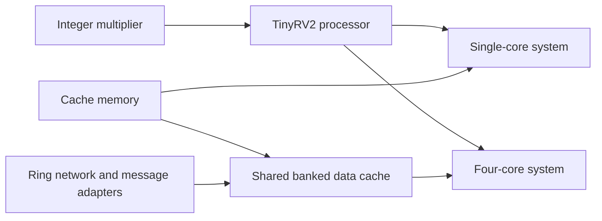

# TinyRISC-V Projects

**From integer multiplication to a four-core processor system.**

A collection of computer architecture projects built with **Verilog/SystemVerilog**, **Python**, and **PyMTL3**. The designs explore arithmetic hardware, pipelined execution, cache organization, and on-chip communication using the TinyRV2 educational subset of RISC-V.

Each project includes implementation source, simulation models, and tests. Baseline and alternative designs make it possible to study different architectural choices within the same framework.

## Projects

| Project | Focus | Implementations and components |
| --- | --- | --- |
| [Integer Multiplier](sim/imul/) | Iterative arithmetic and latency | Fixed-latency shift-and-add multiplier, variable-latency multiplier with zero-bit skipping, and a functional reference model |
| [Pipelined Processor](sim/processor/) | TinyRV2 instruction execution | Five-stage baseline and alternative pipelines, data hazard handling, operand bypassing in the alternative design, ALU, immediate generation, and integer multiplication |
| [Cache Memory](sim/cache/) | Locality and memory hierarchy | Direct-mapped baseline and two-way set-associative alternative blocking caches, write-back/refill control, and one-bank/four-bank configurations |
| [Multicore System](sim/multicore/) | System integration and communication | Single-core and four-core systems, ring network routers, message adapters, and a shared four-bank data cache subsystem |

## How the pieces fit together



The processor uses the variable-latency multiplier. The integrated RTL systems use the alternative processor and cache designs. The multicore design combines four processors with private instruction caches and a shared banked data cache connected through request and response networks.

### Integer Multiplier

Accepts two 32-bit operands and returns the low 32 bits of their product through ready/valid streaming interfaces. `IntMulBase` implements fixed-latency iterative multiplication; `IntMulAlt` uses a priority encoder to skip runs of zero bits. `IntMulFL` provides a functional reference. The simulator includes several operand distributions for comparing cycle counts.

### Pipelined Processor

Implements fetch, decode, execute, memory, and writeback stages. The source includes instruction encoding/assembly support, a functional processor model, RTL control/datapath modules, and instruction tests covering arithmetic, logic, shifts, branches, jumps, loads/stores, multiplication, and manager CSR communication.

Assembly microbenchmarks include vector addition, complex multiplication, masked filtering, and binary search. TinyRV2 is an educational instruction subset; this repository does not claim full RISC-V ISA compliance.

### Cache Memory

Compares a direct-mapped cache with a two-way set-associative design. Both use 16-byte cache lines and 32-bit processor-side data messages, with control paths for hits, misses, refills, and dirty evictions. Tests exercise cache requests, conflicts, delays, and bank configurations.

### Multicore System

Builds on the processor and cache projects to explore integration. Components include three-port routers, a four-node ring, cache/memory message adapters, single-core and multicore functional models, and RTL system models. The source exposes instruction-commit and cache access/miss signals for simulation statistics.

## Repository layout

```text
tinyriscv-projects/
├── README.md
├── .gitignore
├── sim/
│   ├── imul/          # Integer multiplier models, RTL, tests, imul-sim
│   ├── processor/     # Processor models, RTL, instruction tests, proc-sim
│   ├── cache/         # Cache models, RTL, tests, mem-sim
│   ├── multicore/     # Networks, integrated systems, tests, sys-sim
│   ├── vc/            # Shared Verilog components and test utilities
│   ├── conftest.py
│   ├── pymtl.ini
│   └── pytest.ini
└── app/
    ├── ece4750/       # Runtime and support library
    ├── simple/        # Small C examples
    ├── ubmark/        # Single-threaded benchmarks
    ├── mtbmark/       # Multithreaded benchmarks
    └── ...            # Autoconf build files and toolchain scripts
```

The four projects share imports and Verilog includes, so keep the `sim/` tree together. Generated simulator output, native build directories, caches, and the original Git history are excluded from this curated repository.

## Simulation and testing

The original course environment supplies Python with PyMTL3 and pytest, plus Verilator and a C++ toolchain for RTL simulation. Building TinyRV2 application binaries also requires a compatible RISC-V cross compiler. Exact dependency versions were not recorded in the source; the original course environment is the best starting point.

Run from a separate build directory so generated simulation files stay out of the source tree:

```bash
mkdir -p sim/build
cd sim/build

# Run the existing project suites
python -m pytest ../imul
python -m pytest ../processor
python -m pytest ../cache
python -m pytest ../multicore

# Compare multiplier implementations
python ../imul/imul-sim --impl base --input small --stats
python ../imul/imul-sim --impl alt --input small --stats

# Run an assembly microbenchmark on the alternative processor
python ../processor/proc-sim --impl alt --input vvadd-unopt --verify --stats

# Exercise the alternative cache
python ../cache/mem-sim --impl alt --input loop1 --stats
```

`sys-sim` consumes a TinyRV2 ELF binary, rather than the assembly input names used by `proc-sim`. It supports `score-fl`, `mcore-fl`, `base`, and `alt` implementations. Run each simulator with `--help` in the configured environment for its options.

**Validation status:** The curated copy passed Python syntax checks and static checks of renamed package references and active Verilog include paths. Hardware simulations and the 49 existing test modules have not been rerun for this copy. No performance improvement or passing-test claim is implied by the presence of baseline/alternative designs.

## Credits

Developed by **Helen Ni and Selena Zhang** for **Cornell ECE 4750, Fall 2025**, as recorded in the original repository. The project includes course-provided infrastructure and support code; existing source attribution is preserved, including simulator credits to Christopher Batten and Shunning Jiang.

The folders were renamed from their original numbered assignment names to describe their architectural roles. This is a curated presentation of the coursework and its supporting framework. No new license has been applied to the inherited source.
