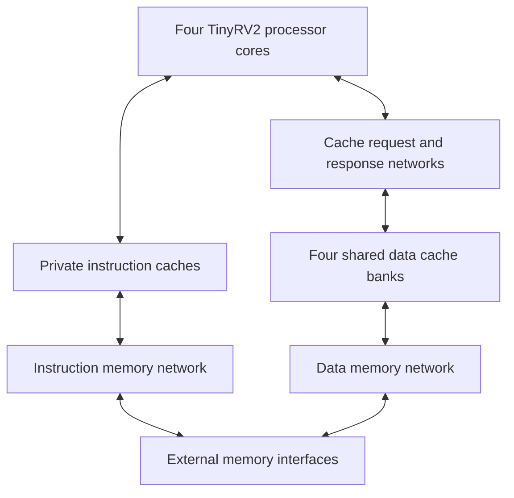

# TinyRISC-V Processor Systems

**A 32-bit processor architecture project spanning arithmetic hardware, pipelined execution, cache memory, and a four-core system.**

Built with **Verilog/SystemVerilog · Python · PyMTL3 · pytest**

Developed by Helen Ni and Selena Zhang.

## Overview

This repository brings together four connected hardware projects, from a standalone integer multiplier to a multicore processor with a shared banked data cache. The processor executes **TinyRV2**, an educational subset of the RISC-V instruction set.

The focus is on the hardware decisions behind execution: how to handle data dependencies in a pipeline, reduce unnecessary multiplication cycles, organize cache storage, and route memory requests between cores and cache banks. The repository includes register-transfer-level (RTL) implementations, Python functional reference models, simulation drivers, and tests.

## Projects and design decisions

| Project | Implementation | Design question |
| --- | --- | --- |
| [Integer multiplier](sim/imul/) | 32-bit iterative multiplication; fixed-latency baseline and variable-latency alternative with zero-bit skipping | How can operand values reduce the work required by a shift-and-add multiplier? |
| [Pipelined processor](sim/processor/) | Five-stage TinyRV2 pipelines, hazard control, operand bypassing, branches, loads/stores, and multiplication | When can a dependent instruction use a forwarded result, and when must the pipeline stall? |
| [Cache memory](sim/cache/) | Direct-mapped and two-way set-associative blocking caches; 16-byte lines, dirty eviction, and refill control | How does associativity change conflict behavior and the control needed to select a cache line? |
| [Multicore system](sim/multicore/) | Single-core and four-core integration, private instruction caches, a shared four-bank data cache, and ring-network communication | How do routing, arbitration, and backpressure coordinate access to shared memory resources? |

## System architecture



The integrated RTL systems use the alternative processor and cache designs. Each processor includes the variable-latency multiplier. Network messages carry requests and responses between components; ready/valid handshakes allow a receiver to pause transfers when it cannot accept more work.

The router sends nonlocal packets clockwise around a four-node ring. Its switch uses fixed-priority arbitration. These are concrete routing and arbitration choices to inspect when considering contention and fairness.

## Explore the implementation

- **Pipeline control and forwarding:** [processor control](sim/processor/ProcAltCtrl.v) and [datapath](sim/processor/ProcAltDpath.v).
- **Arithmetic optimization:** [variable-latency multiplier](sim/imul/IntMulAlt.v), alongside the [fixed-latency baseline](sim/imul/IntMulBase.v).
- **Cache hit, miss, and eviction handling:** [two-way cache controller](sim/cache/CacheAltCtrl.v) and [datapath](sim/cache/CacheAltDpath.v).
- **System integration:** [four-core top level](sim/multicore/MultiCoreSys.v), [banked data cache](sim/multicore/MultiCoreDataCache.v), and [ring network](sim/multicore/Net.v).

Shared Verilog components live in [`sim/vc/`](sim/vc/). [`app/`](app/) contains the runtime and C benchmarks; [`sim/processor/ubmark/`](sim/processor/ubmark/) contains assembly microbenchmarks for vector addition, complex multiplication, masked filtering, and binary search.

## Verification and evaluation

The repository contains **49 test modules** across arithmetic, processor instructions, caches, networks, and integrated systems. Functional and RTL implementations reuse test harnesses and test cases. The suites include operand and instruction cases, dependency scenarios, and delayed source/sink or memory responses.

Simulation drivers expose cycle statistics, instruction statistics, cache access/miss statistics, line traces, and waveform output where supported. Baseline and alternative implementations provide a way to investigate architectural tradeoffs using the same workloads.

**Current status:** Python syntax and local import/include checks passed after the folders were renamed. The simulation suites have not been rerun in this repository's current environment, and measured benchmark results are not yet published. TinyRV2 implements a subset of RISC-V.

## Run a simulation

Use an environment with **Python, PyMTL3, pytest, Verilator, and a C++ compiler**. Exact dependency versions are not pinned in this repository. In that environment:

```bash
git clone https://github.com/hn347/tinyriscv-projects.git
cd tinyriscv-projects
mkdir -p sim/build
cd sim/build

# Run the alternative multiplier's existing tests
python -m pytest ../imul/test/IntMulAlt_test.py

# Compare multiplication cycle statistics on the same input set
python ../imul/imul-sim --impl base --input small --stats
python ../imul/imul-sim --impl alt --input small --stats
```

See [Simulation and testing](docs/SIMULATION.md) for all four test suites, processor/cache examples, system simulation requirements, and toolchain notes.
